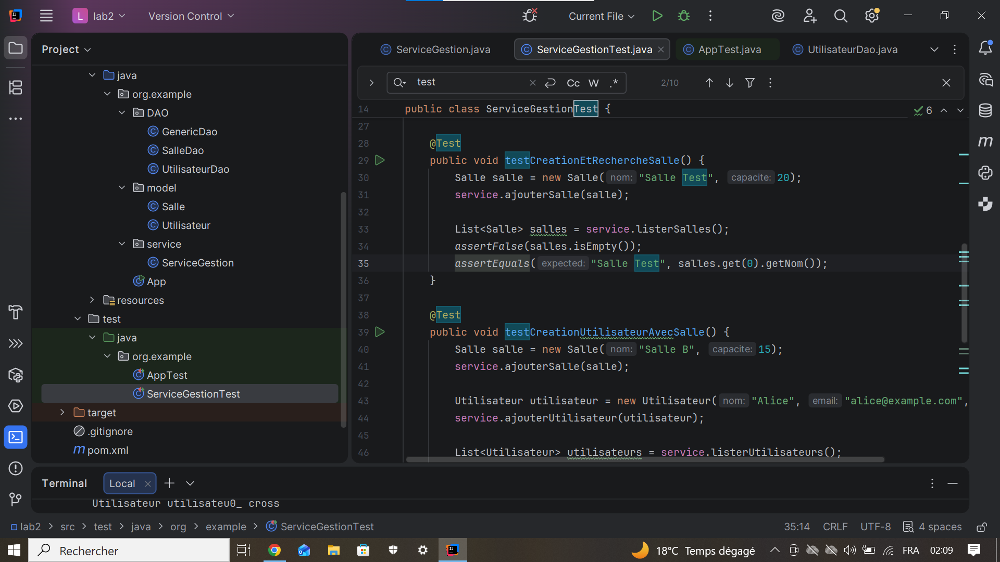
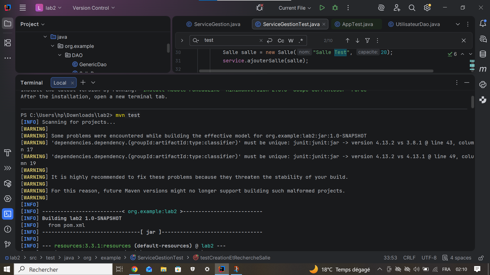
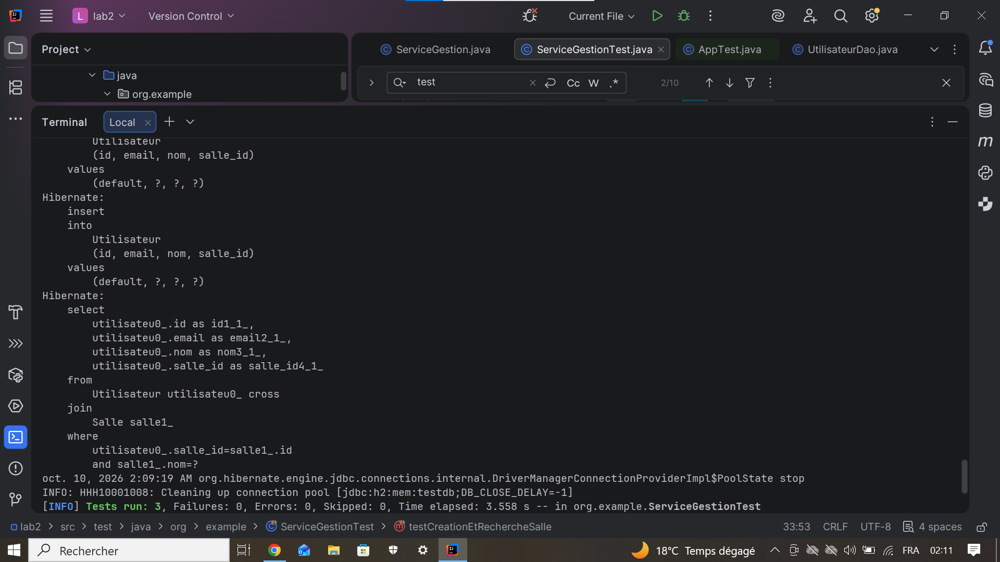
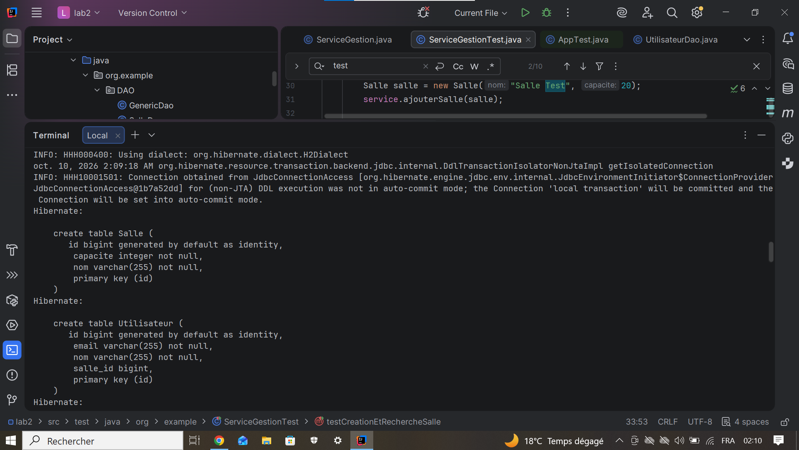

# lab2

Ce projet est un petit TP Java/Maven pour tester la gestion des salles et des utilisateurs avec Hibernate. J'ai ajoute quelques captures pour montrer le code, les tests et le resultat dans le terminal.

## Captures du projet

### Test du service

Dans cette capture, on voit la classe `ServiceGestionTest` avec des tests pour creer une salle et verifier la liste des salles.

### Execution avec Maven

Ici, j'ai lance la commande `mvn test` pour verifier que le projet compile et que les tests s'executent.

### Resultat des tests

Cette capture montre que les tests sont passes avec succes dans le terminal.

### Creation des tables Hibernate

Dans cette partie, Hibernate cree les tables `Salle` et `Utilisateur` dans la base de donnees de test.

